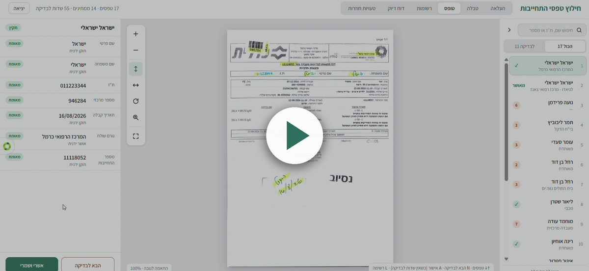

<div align="center">

# 🧾 FormExtract

**חילוץ שדות מטפסי התחייבות של מעבדת וירוסים, בלי לנחש**


[🌐 Live demo](https://formextract.onrender.com) · [✨ Smart memory](#-original-feature-smart-memory) · [🏗️ Architecture](#%EF%B8%8F-architecture) · [📊 Accuracy](#-measuring-accuracy) · [🚀 Run it](#-run-it-locally)

</div>

<div align="center">

<a href="https://drive.google.com/file/d/1nvy_cGF9nPxZpJGG9YwGDXKosNjT8gCk/view" title="Watch the demo video">
  
</a>

*▶ [Watch the demo video](https://drive.google.com/file/d/1nvy_cGF9nPxZpJGG9YwGDXKosNjT8gCk/view). The form shown is a sample page with fictional data.*

</div>

Extracts the required fields from Hebrew lab commitment forms (printed, scanned, photographed or handwritten), **flags every value it is not sure about**, and lets a lab technician check, correct and approve them in a Hebrew right-to-left web app. Approved records are stored in a database behind a REST API and can be exported to Excel.

> [!IMPORTANT]
> **Guiding principle:** an empty, flagged field is better than a guessed value. The system is judged not only by how often it is right, but by how well it knows when it is wrong.

📚 Design decisions (ADRs), measured results and the schedule are in [PLAN.md](PLAN.md); a short summary is in [SUMMARY.md](SUMMARY.md).

## 🔄 What it does

| | Step | What happens |
|---|---|---|
| 📤 | **Upload** | A PDF or image (also HEIC and phone photos). The form is visible at once, while its fields are still being read in the background. |
| 🔍 | **Read** | Each page is cleaned up locally and read by a vision model. It is turned upright first (sideways scans locally, upside-down ones after a model check). |
| 👩‍🔬 | **Review** | Every field shows how sure the system is. The technician corrects or confirms them next to the form image. |
| ✅ | **Approve and export** | Approved records can be searched, filtered and exported to Excel or CSV. |

**Fields:** first name, last name, ID number, central number(s), received date, sender, commitment number(s).

## 🎯 How the answer is trusted

Confidence is **never taken from the model**. The model only extracts. Our code decides how far to trust each value (`backend/app/pipeline/extract.py`):

| | Level | Meaning |
|---|---|---|
| 🟢 | **High** | Independently verified: a barcode match, an ID that passes its check digit *and* is corroborated (read twice, or highlighted), an exact match to the closed list of 55 senders. |
| 🟡 | **Medium** | Read consistently from print, but nothing could verify it. Shown in a pale yellow: a quick look. |
| 🟠 | **Low** | Failed a check, handwritten, inconsistent reads, or not found. A missing field stays empty and is flagged "not found". |

Nothing that is not high is ever shown as verified. Highlights on the sample forms are only extra evidence: real forms may have none, so the model extracts by labels and position ("התחייבות", "דרישה", "דגימה", "מרכזי").

## ✨ Original feature: smart memory

When the same mistake keeps being corrected the same way on one sender's forms (at least 3 times, at least 75% agreeing), the next form with that reading shows a suggestion: *"on earlier forms the sender was read as X and corrected to Y (3 of 3)"*. The technician presses **apply** or **ignore**.

> [!NOTE]
> **Nothing is ever applied automatically**, so a wrong habit cannot spread unnoticed.

- 🧠 It learns from real corrections, without training a model.
- 🏷️ It helps most with the **sender**, which comes from a closed list, so the same wrong reading really repeats. Numbers differ on every form, so they get no suggestions.
- 📋 The **טעויות חוזרות** tab (developer role) lists all repeated corrections by field and sender, and counts the ones that were shown as certain: the dangerous kind.
- 🎬 To see a suggestion without waiting for real corrections: `python scripts/seed_suggestion_demo.py` (from `backend/`). It creates fictional demo forms, named "דמו", and corrects them through the real code. **Say it is demo data when you show it.**

## 🏗️ Architecture

```
file → page images → turn sideways pages → local enhancement → local barcodes
     → one vision-model call per page (structured JSON)
       (if the model says the page is upside down: flip it and ask once more)
     → normalization + validation + confidence → PostgreSQL (status: pending)
     → human review → confirm or correct → approve
```

| | Part | Technology |
|---|---|---|
| 🖥️ | Interface | React, TypeScript, Vite, Tailwind, TanStack Query (Hebrew, right to left) |
| ⚙️ | API | Python, FastAPI, SQLAlchemy; background processing; one server serves both the interface and the API |
| 🗄️ | Database | PostgreSQL |
| 🖼️ | Image work (no AI) | PyMuPDF (PDF pages), OpenCV (turn, deskew, contrast), zxing-cpp (barcodes) |
| 🤖 | Model | Gemini 2.5 Flash, with other Gemini models and Groq (`qwen3.8-27b`) as fallbacks when a model is out of quota or busy |
| 📦 | Deployment | Docker, Render |

🔐 Two roles, set by two passwords in `.env`: a **user** (upload, table, form, records) and a **developer** (also the accuracy and repeated-mistakes screens). The server enforces it, and an empty password means nobody can log in as that role.

## 📊 Measuring accuracy

The project's "eval": 48 sample pages with hand-verified answers, split into 34 development and 14 test pages (do not tune on the test pages). For each field it reports accuracy, the share flagged, and **errors that were not flagged**: the metric that matters most, because those reach the database unnoticed. The **דוח דיוק** tab shows saved runs side by side and refuses to compare runs that covered different pages.

```bash
cd backend
python scripts/evaluate.py --provider gemini --split dev                 # calls the API, caches the answers
python scripts/evaluate.py --provider gemini --split dev --cached-only   # re-score from the cache, no API calls
python scripts/compare.py --a gemini:gemini-2.5-flash --a-no-orient --b groq:qwen/qwen3.8-27b --split dev --skip-sideways
```

> [!WARNING]
> **What is and is not established:** the numbers come from yellow-highlighted samples and few pages, so they are probably optimistic. The held-out test set was run on 11 of 14 pages (1 error in 55 values was not flagged). Unmarked forms were not measured. Results are in PLAN section 10.

## 🚀 Run it locally

Needs Python, Node and Docker Desktop. Developed on Python 3.14 and Node 25.

```bash
cd backend
python -m venv .venv
.venv/Scripts/pip install -r requirements.txt     # Windows; use .venv/bin/pip on Linux/macOS
cp ../.env.example ../.env                          # then fill in GEMINI_API_KEY and the two passwords
```

```powershell
.\start.ps1 -Seed        # Windows: database, interface and API on one server; -Seed loads the sample forms
./start.sh --seed        # Linux / macOS / Git Bash
```

Open **http://localhost:8000**. `-Seed` loads 44 sample forms from **saved model answers** (replayed through the real pipeline, no model call), each marked "(saved answer)": **say so when you present it.** It needs `data/pages` (the rendered sample pages, not in the repo; see `scripts/render_samples.py`).

### 🧪 Tests

| Layer | Command |
|---|---|
| Backend (pipeline rules, database, API, export, quota, orientation) | `cd backend && python -m pytest` |
| Frontend (logic and components) | `cd frontend && npm test` |
| Browser end to end (real frontend and API in Chromium, scripted model, no quota) | `cd frontend && npm run test:e2e` |

## ☁️ Deployment

`Dockerfile` builds the interface and the API into one image; `render.yaml` describes one web service and one Postgres database (Render: **New > Blueprint**). Set `GEMINI_API_KEY` (and optionally `GROQ_API_KEY`); the two passwords can be generated.

> [!WARNING]
> On Render's free plan, **uploaded images do not survive a restart or deploy** (records stay in the database), the service sleeps when idle, and a page being read during a restart stays "בעיבוד".

## ⚠️ Known limitations

- 🔑 **Model quota.** Gemini's free tier allows about 20 requests per day per model, and Groq is lower in accuracy and limited to about 50 pages a day. A real lab needs a paid tier or a local model.
- ✍️ **Handwriting.** Handwritten digits are often misread; they are flagged, never guessed, and handwritten names are never trusted.
- 🔃 **Upside-down pages** are detected only through the model's own flag, at the cost of one extra call for such a page.
- 📄 **Forms spanning several pages**, or several forms on one page, are not supported (none exist in the samples).
- 🔒 **Security.** No lockout after wrong passwords, and the session cookie is not yet marked Secure. Exported files contain names and ID numbers and must be treated as patient data.

## 🛡️ Privacy

Orientation, barcodes and image enhancement run locally. Only the page image is sent to the external model, and field values are not written to logs. The free Gemini tier may use inputs to improve Google's products: acceptable for the altered sample data, **not** for real patient data. A real lab would use a paid tier or a local model.
